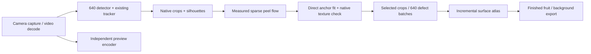

# 640-pixel streaming inspection prototype

Both trained models retain **640 × 640** inputs. This implementation adds an
experimental online mapping profile and two optimisations to the default
reference profile. Real-time throughput and field accuracy are separate checks;
passing the synthetic controls does not establish either on the conveyor.

The default remains `reference`: its existing texture search and view selection
are retained, with vectorised surface fusion and defect batches of up to four.
The experimental `realtime` profile is opt-in because the initial real-video
comparison lost mapping support. No trained checkpoint is changed.

The final original-video trial processed 795 frames in 823.9 seconds:
**0.965 FPS** against a 29.93 FPS source, with 28 partial maps and zero complete
maps. Segmentation batching improved a separate eight-crop microbenchmark from
11.24 to 31.47 crops/s; it did not make the complete pipeline real time.

## Run the prototype

Stop the existing backend, then start it from the project root in PowerShell:

```powershell
$env:FRUIT_PIPELINE = 'realtime'
npm run dev
```

Upload a video or use the existing **Start live** control. If the launcher reuses
an already running backend, that process retains its earlier environment;
restart it to change profiles. `/api/health` exposes `pipeline_profile` and
`model_input_size`. Set `$env:FRUIT_PIPELINE = 'reference'` before restarting
to use the default profile again.

The prototype defaults to FP32. The local FP16 experiment was slower and changed
some model predictions, so it is available only through
`$env:FRUIT_MIXED_PRECISION = '1'`. This is CUDA autocast, not quantisation.
`FRUIT_SEGMENTATION_BATCH` accepts 1–8 (default 4);
`FRUIT_ROTATION_RECOVERIES` sets the maximum full-search attempts per fruit
(default 1, zero disables recovery). `FRUIT_OPENCV_THREADS` defaults to 1 for
the prototype because four independent fruit workers already run in parallel.

## Processing and evidence



- Camera acquisition has a four-frame ring and its own thread. JPEG preview
  encoding is separate and capped at 12 Hz; it no longer limits acquisition.
  Each captured frame carries its original sequence and monotonic timestamp.
  Overrun gaps remain visible to the motion and identity checks.
- Detection and tracking still inspect every processed frame. A bounded GPU
  queue serialises model access and prioritises waiting detector requests over
  waiting segmentation batches. Overload raises an explicit error. Capture
  drops are counted for live input; recorded-video replay drops no frames.
- Four CPU workers process different fruit independently. Ellipse fits are
  cached within each fruit's short motion window. Sparse LK correspondences
  supply a robust two-component spheroid rotation fit with an analytical
  Jacobian, spatial support checks and a one-pixel residual gate.
- Consecutive measured rotations compose only a seed. A keyframe requires a
  direct anchor measurement, an independent reverse fit and local native
  texture refinement. Nominal spacing is 15 degrees, with a smaller terminal
  or window-end attempt. Neither conveyor velocity nor roller speed supplies
  rotation. A gap, exhausted anchor window or unsupported shape change splits
  the map; disconnected surface segments are never joined by an invented pose.
- Only verified keyframes are segmented. Variable-size crops are letterboxed
  independently to 640; each output returns to its original crop coordinates.
  Binary defect masks retain the existing `> 0.5` decision. Batching can produce
  small floating-point differences from single-crop inference.
- The atlas fuses remapped strips in arrays instead of iterating over map
  columns in Python. Its pixel, class-mask and surface-area calculations match
  the old fusion on the sphere/oblate controls, including overlapping defects
  and measured repeated turns. The temporary final-view extension is replaced
  as new views arrive; it cannot leave stale defects in permanent map cells.
- Each fruit retains eight recent crops, at most 32 selected views per segment,
  and at most two supported segments. Pending segmentation prevents grading.
  Existing identity uncertainty and partial-coverage rules still apply.
  Fruit exports use a separate bounded writer. Stopping or cancelling a run
  drains accepted work and releases the CPU/GPU workers and track buffers.

The preview may be resized for display, and the existing duplicate-frame
comparison uses a small grayscale image. Neither changes either model's input
resolution or the native texture samples used for keyframe verification.

## Measure it

From the project root:

```powershell
# Fresh inference at 640: FP32 / FP16, single crop / batch four
./backend/venv/Scripts/python.exe -B backend/benchmark_realtime.py --models

# Complete original 795-frame replay through both trained models
./backend/venv/Scripts/python.exe -B backend/benchmark_realtime.py --pipeline

# Reference path, or a smaller separately labelled replay
./backend/venv/Scripts/python.exe -B backend/benchmark_realtime.py --pipeline --profile reference --frames 20

# Paired motion comparisons on five immutable saved crop sequences
./backend/venv/Scripts/python.exe -B backend/benchmark_realtime.py --geometry 5

# Geometry, batching, asynchronous evidence gates and cleanup controls
./backend/venv/Scripts/python.exe -B -m unittest discover -s backend -p 'test_*.py'
```

Each benchmark creates a new directory under
`diagnostics/realtime/20261009_implementation/` with the source snapshots,
source/checkpoint hashes, machine information, requested configuration and JSON
results. A production replay also creates a normal report and image evidence
under `results/<job_id>/`. `--frames` reencodes an initial excerpt and labels it;
it is not the untouched full-video benchmark.

`pipeline_fps` includes decoding, crop capture, both models, mapping, the end of
video drain and exports, excluding model loading. `processing_fps` measures only
frame processing. `stage_seconds` for CPU fruit workers are summed CPU task
durations and can exceed wall time because those workers overlap. The defect
latency is the time until a selected view's masks become available. Live reports
also include acquisition-to-processing age and skipped capture frames. A
`meets_source_rate` flag compares complete replay throughput with source FPS;
it does not validate detection recall, physical identity or defect accuracy.

Geometry-only comparisons explicitly use artificial all-clear masks to exercise
fusion and report no defect/grade accuracy. Fresh model benchmarks compare
predictions between execution modes; their IoU is agreement, not labelled
accuracy. Do not count a failed reconstruction as a successful faster map.

See [the implementation results](diagnostics/realtime/20261009_implementation/RESULTS.md)
for the measured outcome and the remaining bottlenecks.
